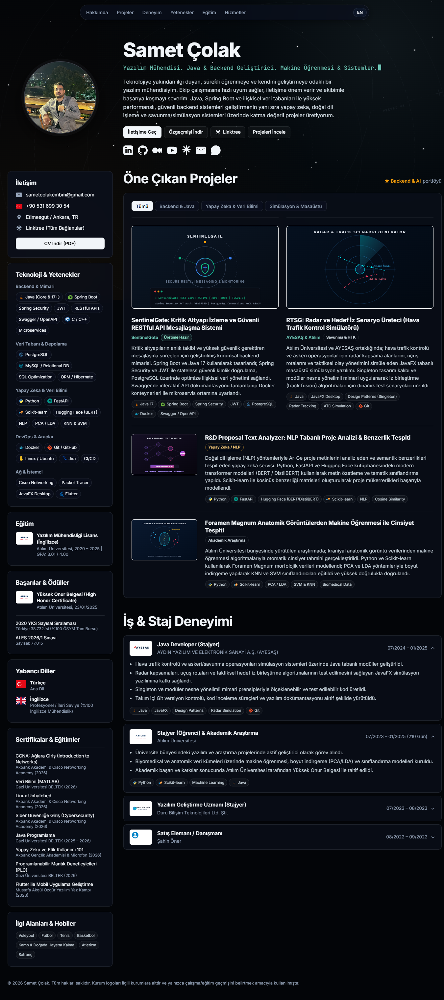

<div align="center">

# 🚀 Samet Çolak — Software Engineering Portfolio

### Backend Architecture • Distributed Systems • Simulation Systems • Applied AI

[](https://sametttclk.github.io/portfolio/)
[](https://developer.mozilla.org/en-US/docs/Web/HTML)
[](https://developer.mozilla.org/en-US/docs/Web/CSS)
[](https://developer.mozilla.org/en-US/docs/Web/JavaScript)
[](https://threejs.org/)
[](https://pages.github.com/)

<br/>

<a href="https://sametttclk.github.io/portfolio/">
  
</a>

<p align="center">
  <b>🔗 <a href="https://sametttclk.github.io/portfolio/">Canlı Web Sitesini Ziyaret Edin (Visit Live Site)</a></b>
</p>

</div>

---

## 🧭 Genel Bakış & Değer Önerisi (Overview)

<details open>
<summary><b>🇹🇷 Türkçe</b></summary>
<p>
Bu repository; savunma sanayii, havacılık ve kurumsal arka yüz mühendisliği alanlarında geliştirilmiş yüksek güvenceli dağıtık sistemleri, radar ve hava trafik kontrol simülasyonlarını ve uçtan uca makine öğrenmesi modellerini sergileyen <b>yüksek performanslı kişisel mühendislik vitrinidir</b>. Harici framework veya ağır paket bağımlılıkları barındırmayan sıfır bağımlılıklı (zero-dependency) saf web mimarisi, <i>2001: A Space Odyssey</i> ve <i>Interstellar</i> sinematografisinden ilham alan karanlık uzay estetiği ile bir araya getirilmiştir.
</p>
</details>

<details open>
<summary><b>🇬🇧 English</b></summary>
<p>
An enterprise-grade, high-performance personal engineering showcase engineered to demonstrate scalable backend architectures, high-assurance distributed services, ATC/radar simulation suites, and applied machine learning models. Built upon a lightweight, zero-dependency vanilla web foundation, it combines modern accessible frontend standards with a cinematic interstellar dark aesthetic inspired by hard science fiction.
</p>
</details>

---

## 🏛️ Mimari & Dosya Yapısı (Architecture & File Structure)

Aşağıdaki tablo projenin modüler dizin organizasyonunu ve her bir bileşenin teknik sorumluluk alanını özetlemektedir:

| Dosya / Dizin | Kapsam & Görev (TR) | Scope & Technical Role (EN) |
| :--- | :--- | :--- |
| **`index.html`** | Ana portfolyo vitrini: Hero, kariyer deneyimi, filtreli projeler, teknik yığın (stack), eğitim ve doğrudan iletişim kartları. | Primary portfolio interface: Hero profile, experience timeline, filterable projects, tech stack, and contact sidebar. |
| **`consulting.html`** | Özel danışmanlık ve mühendislik hizmetleri sayfası (Backend Mimari, Masaüstü Simülasyon, Yapay Zeka/NLP). | Dedicated engineering services & consulting portal (Backend APIs, Desktop Simulators, AI microservices). |
| **`assets/css/site.css`** | Modern CSS3 tasarım sistemi, uzay camı efektleri (`backdrop-filter`), tipografi hiyerarşisi ve tam duyarlı grid mimarisi. | Modular CSS3 design system, dark space-glass tokens, responsive grid/flex layouts, and typography. |
| **`assets/js/site.js`** | Çift dil motoru (TR/EN i18n), WebGL/Canvas derin uzay yıldız alanı, dinamik proje filtreleme ve pürüzsüz DOM kontrolü. | Zero-dependency client scripts: dynamic i18n localization engine, WebGL background, and DOM filtering. |
| **`assets/img/`** | Vektörel teknik logolar (`tech/`), proje mimari şemaları (`work/`), kurum amblemleri (`logos/`) ve optimize görseller. | Scalable vector graphics (`tech/`, `work/`), institutional marks (`logos/`), and optimized media assets. |
| **`assets/docs/`** | İndirilebilir güncel mühendislik özgeçmişi (`Samet_Colak_CV.pdf`). | Downloadable engineering resume document (`Samet_Colak_CV.pdf`). |
| **`sitemap.xml`** | Arama motoru örümcekleri için tüm rota ve öncelik tanımlamalarını içeren XML haritası. | XML sitemap containing canonical URLs and crawling directives for search engines. |
| **`robots.txt`** | Arama motoru botlarına açık dizinleri ve sitemap konumunu belirten kurallar bütünü. | Web crawler directives pointing directly to the portfolio XML sitemap. |

---

## ⚡ Öne Çıkan Teknik Özellikler (Key Highlights)

- **Zero-Dependency (Sıfır Bağımlılık) Mimarisi:**
  Herhangi bir npm derleme adımı (build step), Webpack/Vite paketleyicisi ya da harici UI kütüphanesi gerektirmez. Saf HTML5, modern CSS3 ve Vanilla ES6+ ile yazılmıştır; anında yüklenir, sıfır derleme süresi sağlar ve Lighthouse metriklerinde tam puan sunar.

- **🌐 Dinamik Çift Dil Desteği (TR / EN Seamless Switcher):**
  İstemci taraflı çalışan dinamik dil motoru, sayfa yenilenmeksizin tüm metinleri, başlıkları, butonları ve erişilebilirlik özniteliklerini (`lang`) anında dönüştürür. Kullanıcının dil tercihi `localStorage` üzerinde kalıcı olarak tutulur.

- **🌌 Sinematik Derin Uzay & Paralaks Yıldız Alanı (WebGL / Canvas):**
  `#030508` (deep space void) zemin üzerinde 3 katmanlı derinlik paralaksına sahip ~140 parçacıklı yıldız alanı, sinüs dalgalı ışıma (twinkle) efekti ve 180 saniyelik ultra-yavaş yörünge geometri katmanı içerir. `prefers-reduced-motion` kullanıcı tercihine duyarlıdır.

- **🎯 Kategori Bazlı Anlık Proje Filtreleme:**
  Projeler `Tümü (All)`, `Backend & Java`, `Yapay Zeka & Veri Bilimi (AI)` ve `Simülasyon & Masaüstü` kategorileri arasında DOM animasyonları ile gecikmesiz filtrelenir.

- **💼 Müstakil Hizmetler Modülü (`consulting.html`):**
  Kurumsal iş birlikleri ve freelance mühendislik talepleri için ayrılmış, yetkinlikleri ve somut proje çıktılarını (proof of work) listeleyen bağımsız hizmet sayfası.

---

## 💻 Yerel Geliştirme & Çalıştırma (Local Development)

Projeyi bilgisayarınızda yerel olarak çalıştırmak için harici bir derleme veya bağımlılık yüklemesi gerekmez:

```bash
# 1. Depoyu klonlayın
git clone https://github.com/sametttclk/portfolio.git
cd portfolio

# 2. Herhangi bir yerel statik sunucu ile yayına alın:

# Yöntem A: Node.js (npx serve)
npx serve .

# Yöntem B: Python 3
python -m http.server 8000

# Yöntem C: VS Code kullanıyorsanız
# "Live Server" eklentisiyle index.html dosyasına sağ tıklayıp "Open with Live Server" diyebilirsiniz.
```

Sunucu başladıktan sonra tarayıcınızda `http://localhost:3000` veya `http://localhost:8000` adresine gidebilirsiniz.

---

## 📬 İletişim & Ağ (Contact & Connect)

Projeler, açık kaynak iş birlikleri veya mühendislik fırsatları için bağlantı kurabilirsiniz:

<p align="center">
  <a href="https://www.linkedin.com/in/sametttclk" target="_blank">
    
  </a>
  &nbsp;
  <a href="https://github.com/sametttclk" target="_blank">
    
  </a>
  &nbsp;
  <a href="https://medium.com/@sametcolakcmbm" target="_blank">
    
  </a>
  &nbsp;
  <a href="https://www.youtube.com/@sametcolak4392" target="_blank">
    
  </a>
  &nbsp;
  <a href="https://sametttclk.github.io/linktree/" target="_blank">
    
  </a>
  &nbsp;
  <a href="mailto:sametcolakcmbm@gmail.com">
    
  </a>
</p>

<p align="center">
  <sub>© 2026 Samet Çolak. Tüm hakları saklıdır. Designed with clean engineering standards.</sub>
</p>
